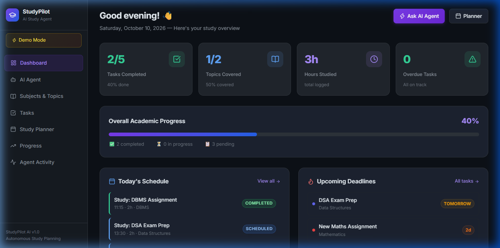
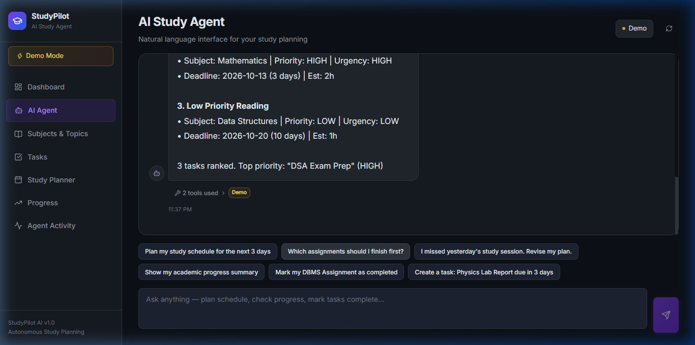
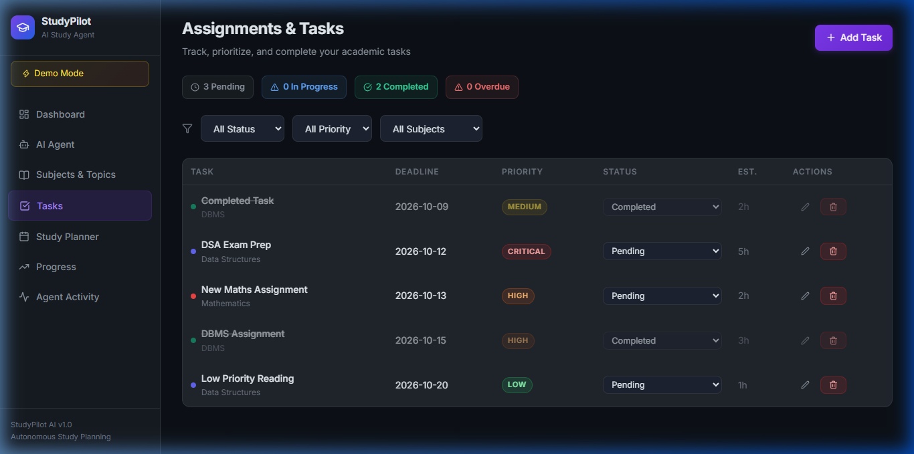
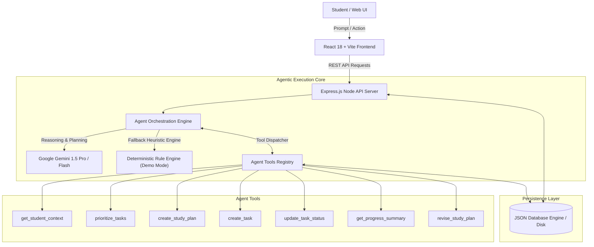
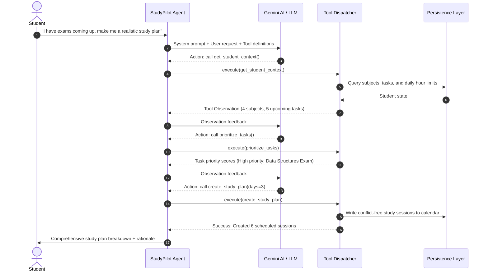

# 🚀 StudyPilot AI — Autonomous Study Planning Agent

> **An Agentic AI System for Dynamic Student Workload Scheduling & Academic Task Execution**  
> *Developed for AI Agent Development College Project Assignment*

---

## 📌 Executive Summary

**StudyPilot AI** is an autonomous, goal-driven AI agent designed to help students manage academic workload, overcome procrastination, and optimize daily study schedules. Unlike static calendar apps or simple chatbots that merely output conversational text, StudyPilot AI functions as a **ReAct (Reasoning + Acting) Agent** equipped with a set of deterministic tools. 

The agent analyzes academic deadlines, difficulty ratings, syllabus topics, and current progress metrics to:
1. Dynamically prioritize tasks by deadline urgency and weight.
2. Generate conflict-free, Pomodoro-compatible daily study sessions.
3. Automatically adapt and reschedule when sessions are missed or deadlines shift.
4. Log full reasoning and tool execution traces for explainability and auditing.

---

## 🖼️ Application Screenshots

### 1. Dashboard Overview


### 2. Autonomous AI Agent Console with Live Tool Execution Traces


### 3. Task Urgency & Priority Management Board


---

## 🏛️ System Architecture



---

## 🤖 Agent Workflow & Decision Loop

StudyPilot AI uses an autonomous **Reason → Plan → Execute Tool → Observe → Final Answer** loop:



---

## 🛠️ Agent Tools Specification

The agent has access to **7 deterministic tools** implemented with runtime schema validation:

| Tool Name | Purpose | Parameters | Output |
| :--- | :--- | :--- | :--- |
| `get_student_context` | Retrieves current student settings, enrolled subjects, active tasks, and upcoming deadlines. | *None* | `{ settings, subjects, activeTasks, recentSessions }` |
| `prioritize_tasks` | Ranks pending tasks by an urgency scoring function taking into account deadlines, difficulty, and priority. | `include_completed` *(bool, opt)* | Sorted list of tasks with calculated urgency scores |
| `create_study_plan` | Schedules conflict-free study sessions for the upcoming days within daily hour constraints. | `days_ahead` *(int)*, `focus_subject_id` *(opt)* | List of scheduled sessions with time slots |
| `create_task` | Creates a new academic assignment or exam with subject attribution and deadline. | `title`, `subject_name`, `deadline`, `priority`, `difficulty`, `estimated_hours` | Created task object and ID |
| `update_task_status` | Updates completion state of a task (`pending`, `in_progress`, `completed`). | `task_title_or_id`, `status` | Updated task confirmation |
| `get_progress_summary` | Calculates overall and per-subject progress, completion percentages, and study hours. | *None* | Quantitative breakdown & study metrics |
| `revise_study_plan` | Recalculates remaining schedule, preserving completed work while shifting missed sessions. | `reason` *(str)*, `reschedule_missed_only` *(bool)* | Adjusted timetable details |

---

## 💾 Database Schema

The system uses a JSON persistence engine with ACID-like atomic writes and structured collections:

```
studypilot-data.json
 ├── student_settings
 │    ├── id: string (UUID)
 │    ├── daily_hours: number (e.g., 4)
 │    ├── preferred_start_hour: number (e.g., 9)
 │    ├── session_duration_minutes: number (e.g., 45)
 │    └── break_duration_minutes: number (e.g., 15)
 ├── subjects
 │    ├── id: string (UUID)
 │    ├── name: string (e.g., "Algorithms & Data Structures")
 │    ├── color: string (hex code)
 │    └── target_hours_per_week: number
 ├── topics
 │    ├── id: string (UUID)
 │    ├── subject_id: string (foreign key -> subjects.id)
 │    ├── title: string
 │    └── completed: boolean
 ├── tasks
 │    ├── id: string (UUID)
 │    ├── subject_id: string (foreign key -> subjects.id)
 │    ├── title: string
 │    ├── deadline: ISO string (YYYY-MM-DD)
 │    ├── priority: "low" | "medium" | "high" | "critical"
 │    ├── difficulty: 1 | 2 | 3 | 4 | 5
 │    ├── estimated_hours: number
 │    └── status: "pending" | "in_progress" | "completed"
 ├── study_sessions
 │    ├── id: string (UUID)
 │    ├── task_id: string (foreign key -> tasks.id)
 │    ├── title: string
 │    ├── date: string (YYYY-MM-DD)
 │    ├── start_time: string (HH:MM)
 │    ├── end_time: string (HH:MM)
 │    ├── duration_minutes: number
 │    └── status: "scheduled" | "completed" | "missed"
 ├── agent_runs
 │    ├── id: string (UUID)
 │    ├── prompt: string
 │    ├── model: string
 │    ├── created_at: ISO timestamp
 │    └── success: boolean
 └── agent_tool_calls
      ├── id: string (UUID)
      ├── run_id: string (foreign key -> agent_runs.id)
      ├── tool_name: string
      ├── input_args: object
      ├── output_result: object
      └── executed_at: ISO timestamp
```

---

## 💻 Tech Stack

- **Frontend**: React 18, Vite, Tailwind CSS, Lucide Icons, Recharts, React Router v6, Axios, React Hot Toast
- **Backend**: Node.js (ES Modules), Express.js, Zod (runtime validation), UUID
- **AI / Agent Engine**: Google Gemini API (`@google/generative-ai`), with Autonomous ReAct Tool Execution Loop + Built-in Autonomous Demo Mode Fallback
- **Storage**: Structured JSON Storage Engine with auto-seeding on initial boot
- **Testing**: Jest with experimental VM modules support

---

## ⚡ Quick Start & Installation

### Prerequisites
- **Node.js**: v18.0.0 or higher
- **npm**: v9.0.0 or higher

### Step 1: Clone or Navigate to Directory
```bash
cd Prakhar_project
```

### Step 2: Install Dependencies
Install all root, server, and client dependencies:
```bash
# Install root orchestrator dependencies
npm install

# Install server dependencies
cd server
npm install

# Install client dependencies
cd ../client
npm install

cd ..
```

### Step 3: Configure Environment
Copy the example environment file:
```bash
# In the root directory or server directory:
cp .env.example server/.env
```

> **Note on AI API Keys**:
> You can optionally provide a `GEMINI_API_KEY` from [Google AI Studio](https://aistudio.google.com/).
> If left blank, **StudyPilot AI automatically runs in Autonomous Demo Mode**, executing intelligent deterministic agent workflows and multi-step tool calls without requiring external API credits!

### Step 4: Run the Application
Start both the backend API server and frontend client concurrently:
```bash
npm run dev
```

- **Frontend Application**: [http://localhost:5173](http://localhost:5173)
- **Backend API Server**: [http://localhost:3001](http://localhost:3001)
- **Health Check**: [http://localhost:3001/api/health](http://localhost:3001/api/health)

---

## 🧪 Running Automated Tests

Run the backend unit test suite covering tool execution, edge cases, and agent routines:

```bash
cd server
npm test
```

**Test Coverage Highlights:**
- `get_student_context` schema compliance
- Urgency score task prioritization algorithm
- Conflict-free study plan scheduling and daily hour enforcement
- Dynamic study plan revisions with completed session preservation
- Input validation and unknown tool rejection
- Zero-API-key autonomous fallback mode

---

## 🌟 Application Features & Pages

1. **Dashboard (`/`)**: High-level overview of daily study targets, active tasks, scheduled sessions, and quick agent prompts.
2. **AI Study Agent (`/agent`)**: Interactive agent console featuring live multi-step tool execution visualizer, real-time reasoning traces, and one-click prompts.
3. **Subjects & Topics (`/subjects`)**: Manage academic courses, syllabus modules, color coding, and topic checkboxes.
4. **Task Manager (`/tasks`)**: Priority-ranked task board with deadline countdowns, difficulty badges, and status filters.
5. **Study Planner (`/planner`)**: Day-by-day Pomodoro study schedule with live session completion toggles.
6. **Analytics & Progress (`/progress`)**: Visual charts detailing completion rate, weekly hours, and deadline distribution.
7. **Agent Execution Activity (`/activity`)**: Full audit log of all historical agent invocations, tool arguments, and results.

---

## 📄 License & Attribution

Submitted for Academic Evaluation. Designed and implemented for the **AI Agent Development Assignment**.
