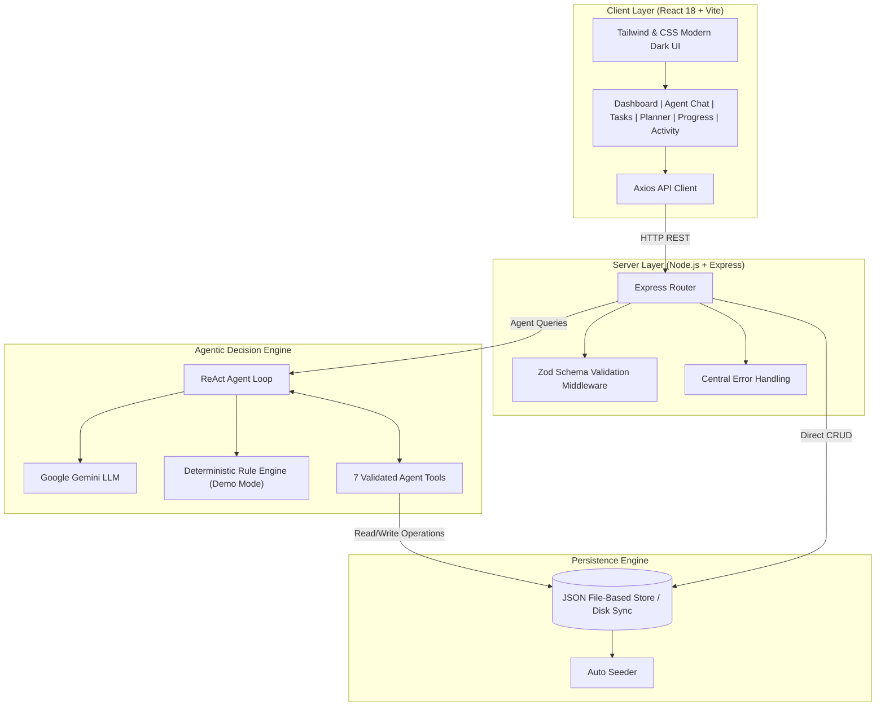
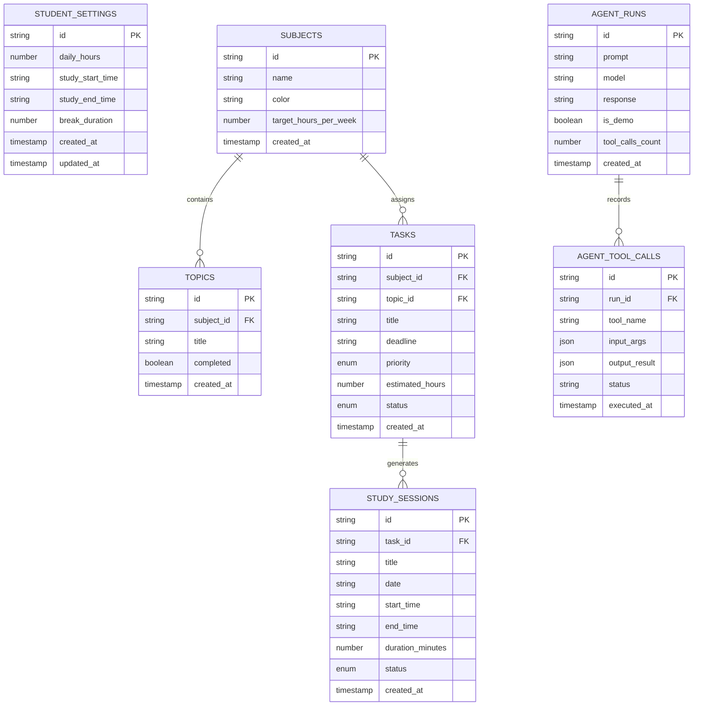

# 📐 StudyPilot AI — System Architecture & Data Schema

This document details the architectural layout, data dictionary, entity-relationship diagrams, and agent tool execution contracts for **StudyPilot AI**.

---

## 1. System Architecture

---

## 2. Entity Relationship Diagram (ERD)

---

## 3. Data Dictionary

### `subjects`
- `id` (String, UUID) — Unique identifier for subject.
- `name` (String, 1-100 chars) — Academic course name (e.g., "Data Structures").
- `color` (String, Hex) — UI badge color (e.g., `#6366f1`).
- `target_hours_per_week` (Number) — Weekly target hours allocated.

### `topics`
- `id` (String, UUID) — Unique identifier for syllabus subtopic.
- `subject_id` (String, UUID) — Foreign key pointing to `subjects.id`.
- `title` (String, 1-150 chars) — Topic heading.
- `completed` (Boolean) — Whether topic mastery is complete.

### `tasks`
- `id` (String, UUID) — Unique task ID.
- `subject_id` (String, UUID) — Associated subject.
- `title` (String, 1-200 chars) — Task assignment name.
- `deadline` (String, YYYY-MM-DD) — Submission deadline date.
- `priority` (Enum) — `low` | `medium` | `high` | `critical`.
- `estimated_hours` (Number, 0.5-50) — Predicted study hours needed.
- `status` (Enum) — `pending` | `in_progress` | `completed`.

### `study_sessions`
- `id` (String, UUID) — Unique session identifier.
- `task_id` (String, UUID, optional) — Linked task.
- `title` (String) — Session description.
- `date` (String, YYYY-MM-DD) — Scheduled date.
- `start_time` (String, HH:MM) — Start time in 24hr format.
- `end_time` (String, HH:MM) — End time in 24hr format.
- `duration_minutes` (Number) — Length in minutes.
- `status` (Enum) — `scheduled` | `completed` | `missed`.

### `agent_runs` & `agent_tool_calls`
Tracks every query processed by the AI agent, capturing prompts, token usage, tool invocations, intermediate observations, and user-facing answers for full auditability.
